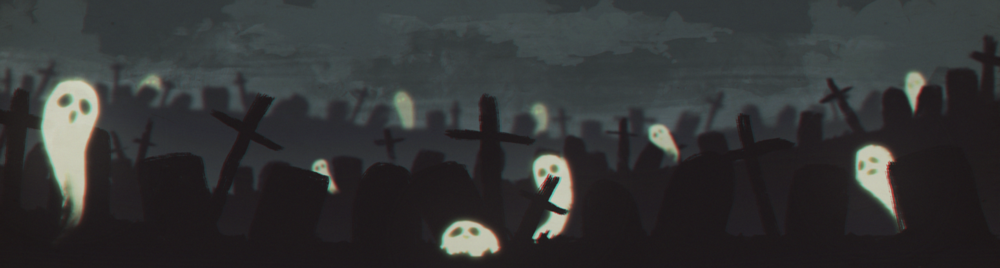
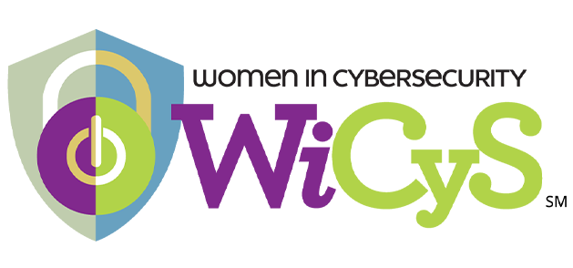
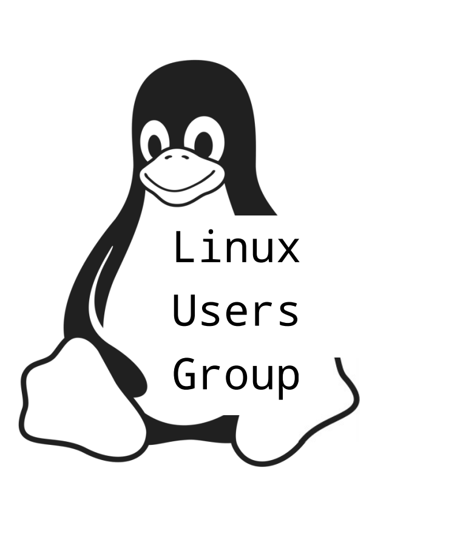

  

<i>A spooky Capture the Flag, hosted by <b>WiCyS</b> × <b>LUG</b></i>

  
  &nbsp;&nbsp;&nbsp;
  

<h1>Hack-O-Ween 👻</h1>

Try out our 6 haunted CTF challenges! Each one hides a flag in the shape `flame{...}`. Bring a flashlight (and a terminal).

  

### The Challenges

  

  
<table width="100%">
  <thead>
    <tr>
      <th align="left">Challenge</th>
      <th align="left">Category</th>
      <th align="center">Points</th>
    </tr>
  </thead>
  <tbody>
    <tr>
      <td><b>The Séance</b></td>
      <td>
        
      </td>
      <td align="center">
        
      </td>
    </tr>
    <tr>
      <td><b>Haunted Candy Chefs</b></td>
      <td>
        
      </td>
      <td align="center">
        
      </td>
    </tr>
    <tr>
      <td><b>Costume Search</b></td>
      <td>
        
      </td>
      <td align="center">
        
      </td>
    </tr>
    <tr>
      <td><b>The Midnight Tour</b></td>
      <td>
        
      </td>
      <td align="center">
        
      </td>
    </tr>
    <tr>
      <td><b>The Haunted Lock</b></td>
      <td>
        
      </td>
      <td align="center">
        
      </td>
    </tr>
    <tr>
      <td><b>Last Transmission</b></td>
      <td>
        
      </td>
      <td align="center">
        
      </td>
    </tr>
  </tbody>
</table>

  

   🕷️  Trick or treat may your exploits be clean and your shells be reverse. 🕷️ 

