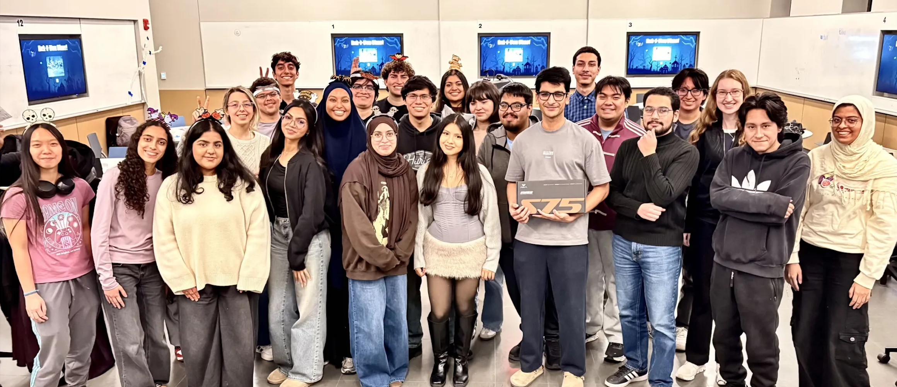

  

  

---
Try out our 10 haunted CTF challenges! Each one hides a flag in the format flame{...}. 

If you enjoy these challenges make sure to come to our future Mini CTFs. Don't forget the main event, Capture the Flame 🔥 which will be in April 2027!

---

## How to Play

Pick whichever option works best for you:

### Option 1: Use the website
Play directly in your browser at **[hack-o-ween-2026.vercel.app](https://hack-o-ween-2026.vercel.app/)**.

> [!IMPORTANT]
> To SSH into the server you must be connected to **UIC WiFi**.

---
### Option 2: Run the challenges locally
Clone this repo and run the challenges on your own machine. Each challenge has its own folder with its files and write-up, organized like this:

<pre> Category/ 
        ├── Challenge/ 
            ├── assets/ 
            |   ├── < Challenge File >
            |   └── toMake/
            |       └── Files to make challenges
            └── < Challenge Write-up >
</pre>

> Not every challenge needs a file, so some won't have an `assets` folder.

---
> [!TIP]
> Need help getting started or connecting over SSH? Check the **[Cyberpack](https://dolomite-milkshake-eae.notion.site/Hack-O-Ween-404487455f7b80329cccc0d263c6e821?source=copy_link)**.

---
### The Challenges

<table width="100%">
  <thead>
    <tr>
      <th align="left">Challenge</th>
      <th align="left">Category</th>
      <th align="center">Points</th>
    </tr>
  </thead>
  <tbody>
    <tr>
      <td><b>Brainiac</b></td>
      <td>
        
      </td>
      <td align="center">
        
      </td>
    </tr>
    <tr>
      <td><b>Haunted Candy Chefs</b></td>
      <td>
        
      </td>
      <td align="center">
        
      </td>
    </tr>
    <tr>
      <td><b>Costume Search</b></td>
      <td>
        
      </td>
      <td align="center">
        
      </td>
    </tr>
    <tr>
      <td><b>The Witches Home</b></td>
      <td>
        
      </td>
      <td align="center">
        
      </td>
    </tr>
    <tr>
      <td><b>The Midnight Tour</b></td>
      <td>
        
      </td>
      <td align="center">
        
      </td>
    </tr>
    <tr>
      <td><b>BackFromTheDed</b></td>
      <td>
        
      </td>
      <td align="center">
        
      </td>
    </tr>
    <tr>
      <td><b>Trojan Hearse</b></td>
      <td>
        
      </td>
      <td align="center">
        
      </td>
    </tr>
    <tr>
      <td><b>The Halloween Lock</b></td>
      <td>
        
      </td>
      <td align="center">
        
      </td>
    </tr>
    <tr>
      <td><b>Last Transmission</b></td>
      <td>
        
      </td>
      <td align="center">
        
      </td>
    </tr>
    <tr>
      <td><b>Graveyard Shift</b></td>
      <td>
        
      </td>
      <td align="center">
        
      </td>
    </tr>
  </tbody>
</table>
